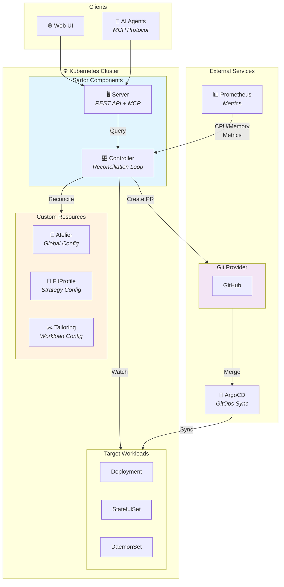

# Sartor

<div align="center">

[](https://github.com/sartorproj/sartor/actions/workflows/ci.yml)
[](https://github.com/sartorproj/sartor/actions/workflows/release.yml)
[](https://github.com/sartorproj/sartor/actions/workflows/security.yml)
[](https://goreportcard.com/report/github.com/sartorproj/sartor)
[](https://codecov.io/gh/sartorproj/sartor)
[](https://opensource.org/licenses/Apache-2.0)
[](https://golang.org/)
[](https://kubernetes.io/)


**Intelligent Kubernetes Resource Optimization with GitOps**

</div>

## Overview

**Sartor** is a Kubernetes controller that automatically optimizes resource requests and limits for your workloads. It observes real usage patterns, calculates intelligent recommendations, and creates GitOps pull requests to apply changes safely.

### Key Features

- 📐 **FitProfiles**: Reusable strategy configuration (percentile or DSP) shared by many workloads
- 📊 **Flexible Recommendation Strategies**: Plugin-based system supporting percentile and DSP-based prediction
- 🔬 **DSP-Based Prediction**: Time series forecasting using FFT and autocorrelation (inspired by [Crane](https://gocrane.io))
- 📈 **Peak Detection**: Detects anomalous peaks in resource usage
- 🧹 **Data Preprocessing**: Automatic imputation, outlier removal, and normalization
- 🔄 **GitOps Write-Back**: Opens one GitHub pull request per workload for raw YAML, Helm values, or Kustomize patches, keeping comments and formatting intact
- 🛡️ **Safety Rails**: Min/max bounds plus a per-PR `maxChangePercent` cap
- ⏸️ **Dry-Run by Default**: Recommendations are written to status only until Git write-back is enabled
- 🚨 **OOM Protection (opt-in)**: Raises memory limits of OOMKilled containers in workloads with a non-paused Tailoring
- 🟢 **VictoriaMetrics Compatible**: Works with any Prometheus-compatible query API, including path prefixes and query parameters

See [Not yet supported](#not-yet-supported) for features that are defined in the API but not implemented.

## Quick Start

### Prerequisites

- Kubernetes cluster
- Prometheus-compatible metrics (Prometheus, VictoriaMetrics, Thanos, ...) with cAdvisor container metrics
- A GitHub repository holding your manifests (only needed for write-back)
- kubectl configured to access your cluster

### Installation

#### Using Helm

The chart is maintained in [sartorproj/sartorproj-helm](https://github.com/sartorproj/sartorproj-helm) and published as an OCI artifact:

```bash
helm install sartor oci://ghcr.io/sartorproj/charts/sartor \
  --namespace sartor-system --create-namespace
```

#### From source

```bash
make install                                    # CRDs
make deploy IMG=ghcr.io/sartorproj/sartor:<tag>  # controller
# or render a single manifest:
make build-installer IMG=ghcr.io/sartorproj/sartor:<tag>   # writes dist/install.yaml
```

### Basic Configuration

1. **Create an Atelier (global configuration):**

```yaml
apiVersion: autoscaling.sartorproj.io/v1alpha1
kind: Atelier
metadata:
  name: default
spec:
  prometheus:
    url: http://prometheus.monitoring.svc:9090
  gitProvider:
    type: github
    secretRef:
      name: github-token
      namespace: sartor-system  # must be the controller's namespace
  prSettings:
    cooldownPeriod: 168h  # durations use Go syntax (h, m, s); "7d" is invalid
    minChangePercent: 20
  safetyRails:
    minCPU: 10m
    minMemory: 64Mi
```

2. **Create a FitProfile (strategy configuration):**

```yaml
apiVersion: autoscaling.sartorproj.io/v1alpha1
kind: FitProfile
metadata:
  name: percentile-balanced
  namespace: production
spec:
  strategy: percentile
  parameters:
    requestsBufferPercent: 20
    limitsBufferPercent: 30
    maxChangePercent: 50  # largest change a single PR may propose
```

3. **Create a Tailoring (per-workload configuration):**

```yaml
apiVersion: autoscaling.sartorproj.io/v1alpha1
kind: Tailoring
metadata:
  name: payment-service
  namespace: production
spec:
  target:
    kind: Deployment
    name: payment-service
  fitProfileRef:
    name: percentile-balanced
  analysisWindow: 168h
  writeBack:
    repository: github.com/org/manifests
    path: apps/payment-service/values.yaml
    type: helm                    # raw, helm or kustomize
    helmValuePath: app.resources  # required for helm
    branch: main
```

4. **Check the recommendation** with `kubectl get tailoring -n production payment-service -o yaml` (`status.lastAnalysis`). To have Sartor open pull requests, start the controller with `--enable-git-writeback`.

More samples live in [config/samples](config/samples).

## Controller Flags

| Flag | Default | Description |
|------|---------|-------------|
| `--enable-git-writeback` | `false` | Open and update pull requests. When `false`, Sartor never reads Git credentials or calls the Git provider. |
| `--analysis-interval` | `6h` | How often each Tailoring is re-analyzed. |
| `--enable-oom-patching` | `false` | Raise memory limits of OOMKilled containers. Only workloads with a non-paused Tailoring are touched. |
| `--leader-elect` | `false` | Enable leader election (use it with more than one replica). |
| `--metrics-bind-address` | `0` | Metrics endpoint address (`0` disables it). |
| `--health-probe-bind-address` | `:8081` | Health and readiness probe address. |

The controller reads Secrets (Git, Prometheus and ArgoCD credentials) with a direct API call and only from its own namespace, taken from the `POD_NAMESPACE` environment variable. A `secretRef` that points to another namespace is rejected. RBAC therefore only needs `get` on Secrets in that namespace.

## Prometheus and VictoriaMetrics

`spec.prometheus.url` is the base URL of a Prometheus-compatible query API. Sartor appends `/api/v1/...` to it and keeps any path prefix and query string, so multi-tenant and cluster-scoped setups work:

```yaml
spec:
  prometheus:
    # Single-node VictoriaMetrics
    url: http://victoria-metrics.monitoring.svc:8428
    # VictoriaMetrics cluster (vmselect, tenant 0), scoped to one cluster's series
    # url: http://vmselect.monitoring.svc:8481/select/0/prometheus?extra_label=cluster=staging-base-cluster
    secretRef:          # optional; keys: username/password (basic) or token (bearer)
      name: vm-auth
      namespace: sartor-system
```

The connection check uses an endpoint that vmselect serves, so `status.prometheusConnected` is accurate for VictoriaMetrics too.

## Git Write-Back

When `--enable-git-writeback` is set, each Tailoring gets one branch, `<prSettings.branchPrefix><namespace>/<name>` (default `sartor/<namespace>/<name>`), and at most one open pull request against `writeBack.branch` (or `prSettings.baseBranch`, default `main`). New recommendations update the open pull request instead of opening another. After a merge, the next change opens a new pull request from the updated base branch.

| `writeBack.type` | File at `writeBack.path` | What changes |
|------------------|--------------------------|--------------|
| `raw` | Kubernetes manifest (multi-document files are supported) | `resources` of the matching containers in the document whose kind and name match `target` |
| `helm` | Helm values file | The map at `helmValuePath`, e.g. `app.resources`. For several containers use `app=app.resources,worker=worker.resources`. The path must already exist. |
| `kustomize` | Strategic merge patch | Container resources in the patch. A missing patch is created and added to the `kustomization.yaml` next to it. |

Edits keep comments, key order, quoting and indentation. Only values that actually change are written, and limits are never added to a container that has none.

Every proposed value is first capped at the FitProfile's `maxChangePercent` (default 50; `100` or more disables the cap) relative to the live workload, then clamped to the safety rails (the FitProfile's `safetyRailsOverride`, otherwise the Atelier's `safetyRails`). The pull request lists each adjustment. `minChangePercent` and `cooldownPeriod` decide when a pull request is worth opening. A Tailoring with `spec.paused: true`, or whose pull request was closed with the `sartor-ignore` label, never touches Git.

### GitHub credentials

Create the Secret in the controller's namespace with either a token:

```bash
kubectl -n sartor-system create secret generic github-token \
  --from-literal=token=<fine-grained token with contents and pull requests read/write>
```

or a GitHub App installation (preferred):

```bash
kubectl -n sartor-system create secret generic github-token \
  --from-literal=appId=123456 \
  --from-literal=installationId=7890123 \
  --from-file=privateKey=sartor.private-key.pem
```

The App needs **Contents** and **Pull requests** read and write permissions on the repository. For GitHub Enterprise Server, set `spec.gitProvider.baseURL` (for example `https://github.example.com`). `writeBack.repository` accepts `org/repo`, `github.com/org/repo` or a clone URL.

## Not yet supported

These fields exist in the API but are not implemented yet. Setting them has no effect beyond what is noted:

- **GitLab and Bitbucket**: only `gitProvider.type: github` can write back.
- **ArgoCD**: Sartor checks connectivity (`status.argoCDConnected`), but `syncOnMerge`, `refreshOnPRCreate` and `hardRefresh` do nothing yet.
- **`batchMode`**: every Tailoring gets its own pull request.
- **OpenCost**: `spec.opencost` is not used by the controller.
- **VPA/HPA detection**: `status.vpaDetected` is always `false`. Do not create Tailorings for workloads a VerticalPodAutoscaler manages.
- **Several Tailorings writing to the same file**: each opens its own pull request, so they can conflict.

## Documentation

- [Getting Started Guide](docs/getting-started.md)
- [Configuration Reference](docs/configuration.md)
- [Recommendation Strategies](docs/recommendation-strategies.md) - Percentile vs DSP strategies
- [DSP Strategy](docs/dsp-strategy.md)
- [Developing Strategies](docs/developing-strategies.md)

## Architecture

Sartor consists of two main components:

1. **Controller**: Kubernetes controller that reconciles `Atelier`, `Tailoring`, and `FitProfile` resources
2. **Server**: REST API and MCP server for UI and AI agent integration



### Data Flow

1. **Metrics Collection**: Controller queries Prometheus (or VictoriaMetrics) for CPU/memory usage patterns
2. **Analysis**: The FitProfile's strategy calculates recommendations, stored in the Tailoring status
3. **PR Creation**: With `--enable-git-writeback`, changes are proposed as GitHub pull requests (raw YAML, Helm, or Kustomize)
4. **GitOps Sync**: After the PR is merged, your GitOps tool (for example ArgoCD auto-sync) applies it
5. **OOM Protection**: With `--enable-oom-patching`, the controller raises limits of OOMKilled containers

## Concepts

### Atelier
Cluster-scoped global configuration defining the Prometheus connection, Git provider, PR settings, and safety rails.

### FitProfile
Namespace-scoped strategy configuration (`percentile` or `dsp`) with its parameters and optional safety rail overrides.

### Tailoring
Namespace-scoped configuration for a specific workload: the target, the FitProfile to use, and where to write recommendations back. Pull request state is tracked in its status (`prState`, `prUrl`, `prNumber`, `branchName`).

## Sample FitProfiles

| Sample | Requests buffer | Limits buffer | `maxChangePercent` | Use Case |
|--------|-----------------|---------------|--------------------|----------|
| [percentile-eco](config/samples/fitprofile-percentile-eco.yaml) | 10% | 20% | 100 (uncapped) | Non-critical workloads |
| [percentile-balanced](config/samples/fitprofile-percentile-balanced.yaml) | 20% | 30% | 50 | Most production workloads |
| [percentile-critical](config/samples/fitprofile-percentile-critical.yaml) | 40% | 50% | 30 | Critical production services |

## Contributing

We welcome contributions! Please see our [Contributing Guide](CONTRIBUTING.md) for details.

1. Fork the repository
2. Create your feature branch (`git checkout -b feature/amazing-feature`)
3. Commit your changes (`git commit -m 'Add some amazing feature'`)
4. Push to the branch (`git push origin feature/amazing-feature`)
5. Open a Pull Request

### Development Setup

```bash
# Clone the repository
git clone https://github.com/sartorproj/sartor.git
cd sartor

# Install dependencies
go mod download

# Run tests
make test

# Run linter
make lint

# Build binaries
make build
```

## Roadmap

- [x] Phase 1: Foundation (MVP)
- [ ] Phase 2: Integrations (Helm, Kustomize and OOM done; ArgoCD sync, GitLab and Bitbucket pending)
- [ ] Phase 3: Intelligence (OpenCost, priority queue, anomaly detection)
- [ ] Phase 4: Interface & GreenOps (MCP server, UI dashboard, CO2 calculations)

## Security

Sartor follows security best practices:

- Regular security scans with Snyk and Trivy
- CodeQL analysis for vulnerability detection
- Go vulnerability checks with `govulncheck`
- Dependency review on all PRs

Report security issues to: security@sartorproj.io

## License

Copyright 2025.

Licensed under the Apache License, Version 2.0 (the "License");
you may not use this file except in compliance with the License.
You may obtain a copy of the License at

    http://www.apache.org/licenses/LICENSE-2.0

Unless required by applicable law or agreed to in writing, software
distributed under the License is distributed on an "AS IS" BASIS,
WITHOUT WARRANTIES OR CONDITIONS OF ANY KIND, either express or implied.
See the License for the specific language governing permissions and
limitations under the License.

## Community

- 📖 [Documentation](https://sartorproj.github.io/sartor)
- 💬 [Discussions](https://github.com/sartorproj/sartor/discussions)
- 🐛 [Issue Tracker](https://github.com/sartorproj/sartor/issues)
- 📧 [Email](mailto:info@sartorproj.io)

## Acknowledgments

- Built with [Kubebuilder](https://kubebuilder.io/)
- Inspired by [VPA](https://github.com/kubernetes/autoscaler/tree/master/vertical-pod-autoscaler) and [Goldilocks](https://github.com/FairwindsOps/goldilocks)

---

<div align="center">

[Website](https://sartorproj.io) • [Documentation](https://sartorproj.github.io/sartor) • [Blog](https://sartorproj.io/blog)

</div>
